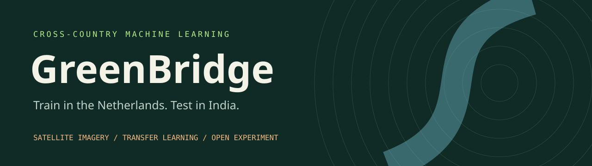
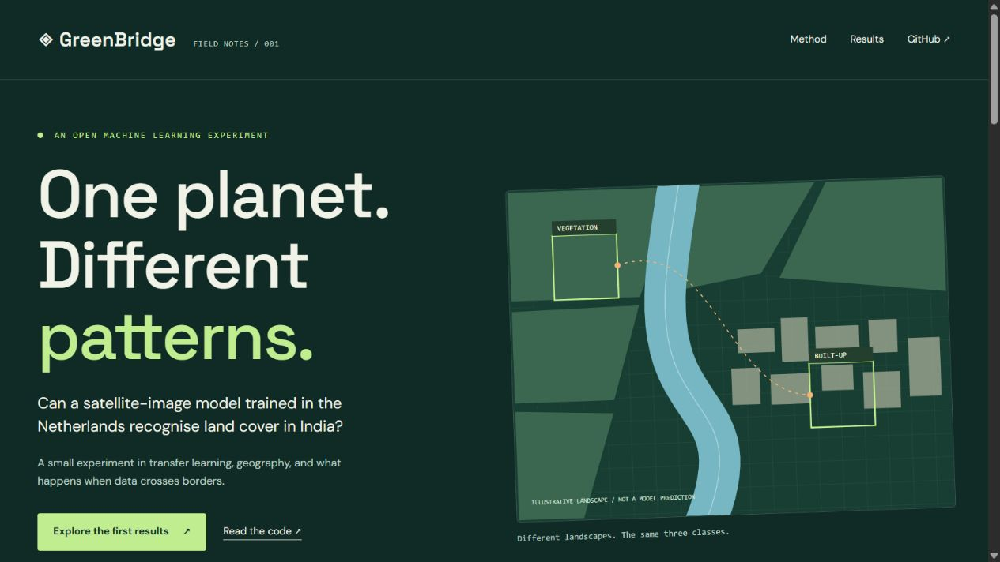
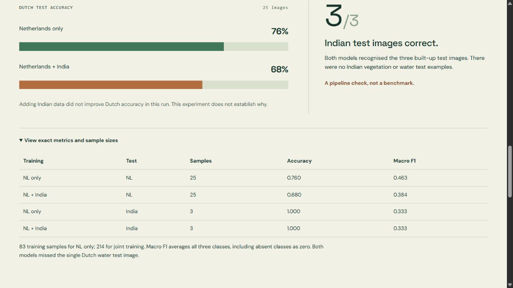

<p align="center"></p>

<p align="center">


</p>

<p align="center"><strong>A small experiment in satellite imagery, transfer learning, and what happens when data crosses borders.</strong></p>
<p align="center"><a href="https://smritis21.github.io/GreenBridge/">GitHub Pages website</a> · <a href="index.html">Website source</a> · <a href="#website-preview">Website screenshots</a> · <a href="docs/RUNNING.md">Full terminal guide</a> · <a href="results/experiment-01.md">Recorded results</a></p>

## The question

Can a land-cover classifier trained around Rotterdam recognise vegetation, built-up land and water around Bengaluru? Does adding Indian training imagery improve its results?

GreenBridge provides a terminal workflow to collect imagery, prepare spatially separated patches, label training data with Claude, train two classifiers and inspect their mistakes. A separate rural area near Bengaluru supplements the urban Indian training crop.

> **Current status:** the pipeline runs and the first experiment is recorded. The evaluation is small and incomplete, especially for India. This is an exploratory prototype, not a validated environmental mapping tool.

## Website preview

The project website explains the question, method, first results, limitations and next steps. Its green, orange and blue palette matches vegetation, built-up land and water. The hero illustration is a schematic, not satellite data or a model prediction.

[Open the local website](http://localhost:8766/) while its preview server is running. Visit the live website: **[smritis21.github.io/GreenBridge](https://smritis21.github.io/GreenBridge/)**. Its entry point is [index.html](index.html) in the repository root.

### Homepage



### Results



## How it works

| Stage | What happens |
|---|---|
| Collect | Download Sentinel-2 RGB crops through Microsoft Planetary Computer. |
| Prepare | Create 64 × 64 patches with separate training and test areas. |
| Label | Claude labels training images; humans label test images. Label sources are recorded. |
| Train | Train a new classification head on frozen pretrained ResNet-18 features. |
| Compare | Evaluate Dutch-only and joint Dutch/Indian training on the same test patches. |
| Report | Save model checkpoints, confusion matrices, class coverage and a readable report. |

**Colour key:** 🟢 vegetation · 🟠 built-up land · 🔵 water

Claude supplies training labels and optional explanations. It is not the model being trained. Its API calls use Anthropic credits; local classifier training does not.

## First experiment

Seed 42, five epochs per model. Dutch-only training used 83 images; joint training used 214.

| Model | Test area | Images | Accuracy | Macro F1 |
|---|---|---:|---:|---:|
| Netherlands only | Netherlands | 25 | 76% | 0.463 |
| Netherlands + India | Netherlands | 25 | 68% | 0.384 |
| Netherlands only | India | 3 | 3/3 correct | 0.333 |
| Netherlands + India | India | 3 | 3/3 correct | 0.333 |

**What happened:** adding Indian training data did not improve Dutch test performance in this run. The drop does not establish a cause. Both models missed the single Dutch water test image.

**Why the Indian result is limited:** all three Indian test examples are built-up. There are no Indian test examples for water or vegetation. These results check that the pipeline runs; they cannot establish generalisation across Indian land-cover classes. Macro F1 averages all three classes, with absent classes contributing zero.

[Raw experiment JSON](results/experiment-01.json) · [Generated report](results/experiment-01.md)

## Quick start

Use Python 3.12. In PowerShell, from the repository folder:

```powershell
py -3.12 -m venv .venv312
.\.venv312\Scripts\python.exe -m pip install -r requirements.txt
.\.venv312\Scripts\python.exe greenbridge.py --help
```

The full download, labelling, training and prediction commands are in the [terminal guide](docs/RUNNING.md). Enter the Anthropic API key at the hidden prompt when using Claude. Do not put it in source files.

### View the website locally

```powershell
.\.venv312\Scripts\python.exe -m http.server 8766 --bind 127.0.0.1 --directory .
```

Open [localhost:8766](http://localhost:8766/). The website is static HTML and CSS and needs no API key or build step. Stop the server with Ctrl+C. The design uses Google Fonts when available and system fonts otherwise.

### Host with GitHub Pages

In the repository settings, open **Pages**, select **Deploy from a branch**, then choose **main** and **/ (root)**. Save the setting. The live website is [smritis21.github.io/GreenBridge](https://smritis21.github.io/GreenBridge/).

The site uses relative asset paths, so it works under the GreenBridge repository URL. No build step or API key is needed.

### Run checks without model training

```powershell
.\.venv312\Scripts\python.exe -m unittest discover -v
```

Sixteen tests currently cover spatial separation, duplicate detection, label handling, Claude response retries, automatic training labels and limited test coverage. Paid calls are mocked in tests. GitHub Actions also runs the checks.

## Limits worth keeping visible

- Training labels are mostly AI generated and may be wrong. Older labels have incomplete source metadata.
- The test set is small and uneven. Some labels were reviewed with Claude suggestions visible, so it is not an independently annotated benchmark.
- The joint dataset produces more training updates per epoch. More data and more updates are confounded.
- Geography, season, image rendering and sampling can affect performance. Only one seed has been run.
- Training includes a nearby rural Indian area, while the current Indian test uses urban images.
- This classifies dominant cover in patches. It does not measure park access, heat exposure or where new parks should go.

## Next steps

- [ ] Verify suitable existing labelled datasets covering both countries.
- [ ] Build larger, independently labelled and geographically separate test sets.
- [ ] Add a simple baseline and matched-data comparisons.
- [ ] Repeat across seeds and show variation.
- [ ] Visualise predictions and errors on a map.

## Repository map

```text
greenbridge.py       Terminal workflow and Claude integration
train.py             Two-model training and evaluation
test_greenbridge.py  Checks without paid API calls
index.html           GitHub Pages entry point
style.css            Website styles
landscape.svg        Website illustration
assets/              README banner and actual website screenshots
results/             Recorded first experiment, without model weights
docs/RUNNING.md      Detailed terminal instructions
```

Raw images, trained model weights, API keys and local environments are not committed. Satellite data and dependencies retain their own terms. Website illustration and banner are schematic project artwork.

Built by [Smriti Sridhar](https://github.com/smritis21).
